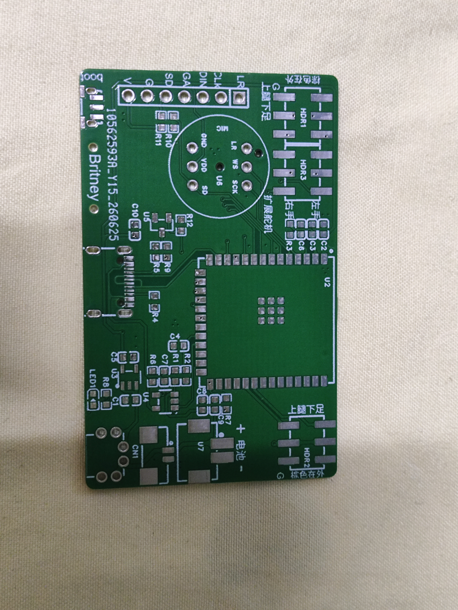
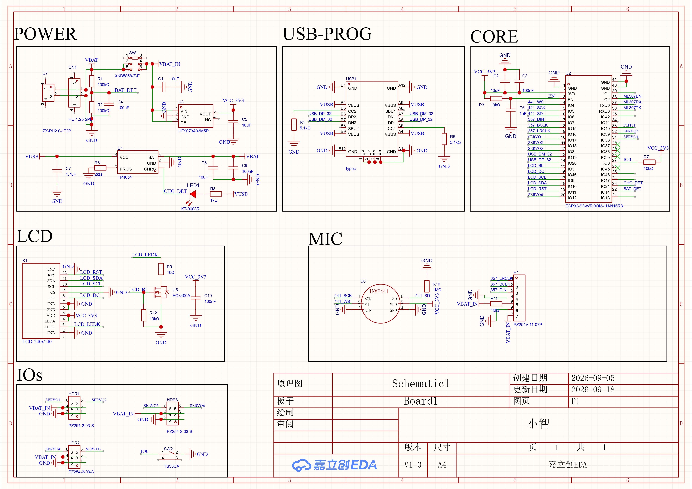
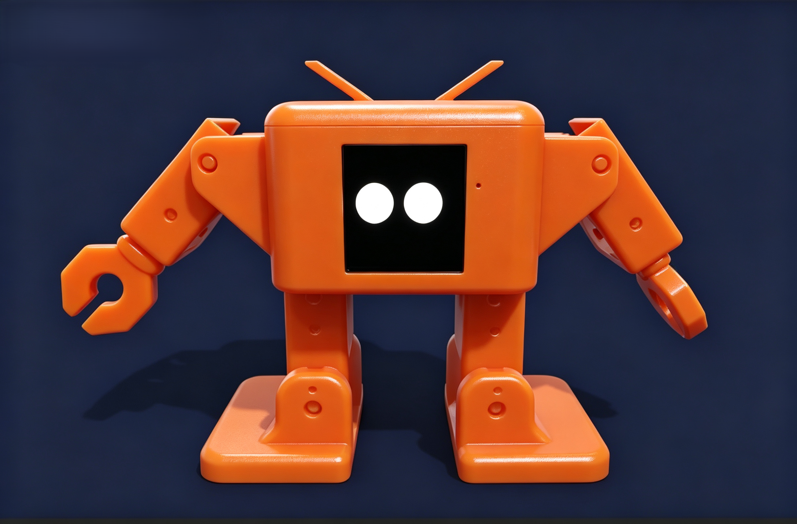

# 基于 AI 大模型的桌面机器人

## 项目简介
基于 ESP32-S3 的对话式 AI 桌面机器人，独立完成 PCB 设计、焊接调试与端云联调。

## 技术栈
- 主控：ESP32-S3（ESP-IDF / C 语言）
- 硬件：双层 PCB、I2S 麦克风/功放、PWM 舵机驱动、Wi-Fi
- 功能：语音采集 → 大模型推理 → 舵机动作反馈，支持多轮对话

## 个人贡献
- 独立完成原理图与双层 PCB Layout
- 编写底层驱动（I2S / PWM / Wi-Fi）
- 端到端联调与问题排查

## 文件说明
- 固件代码后续补充

